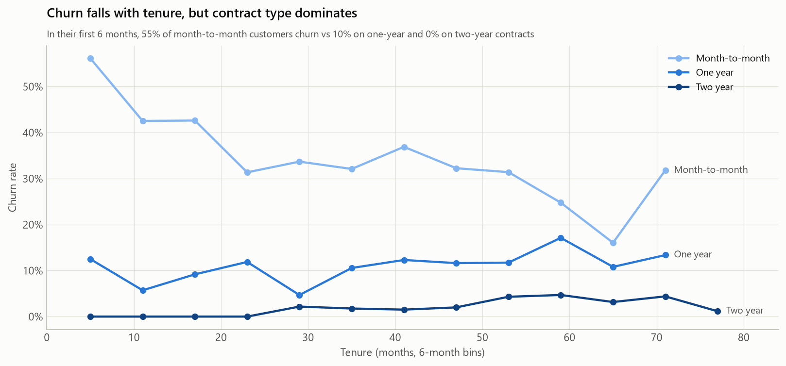
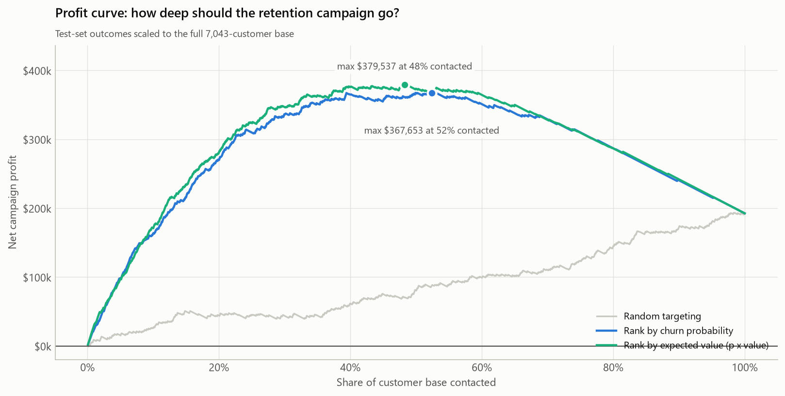
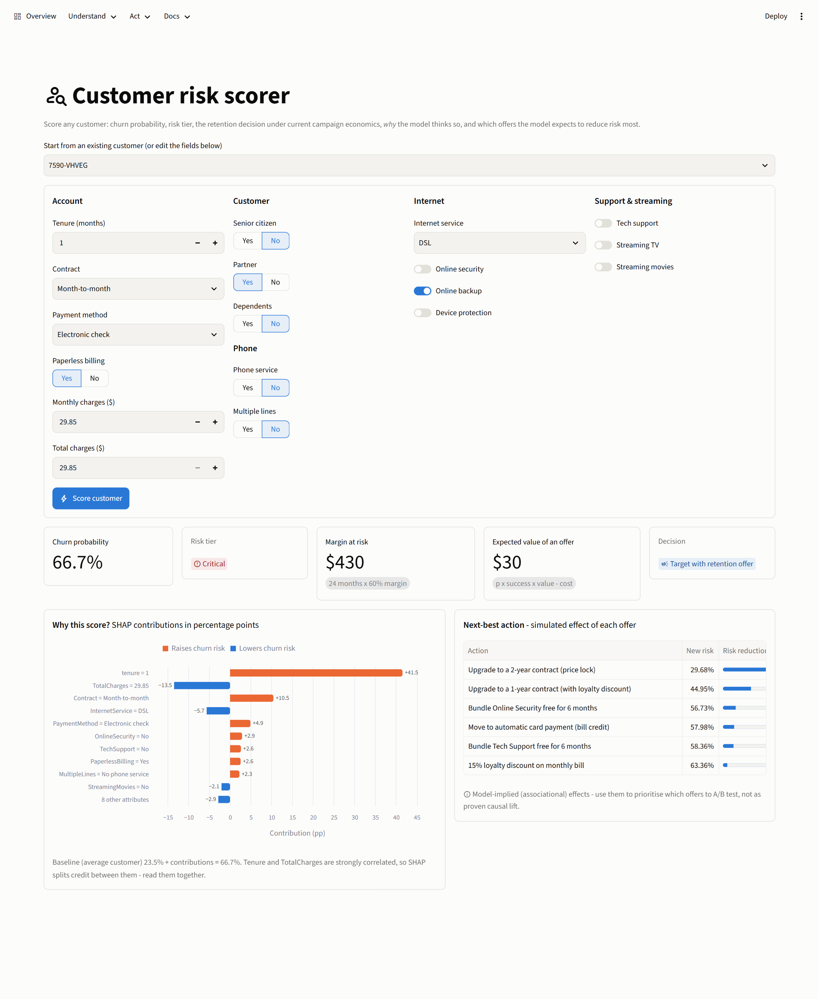
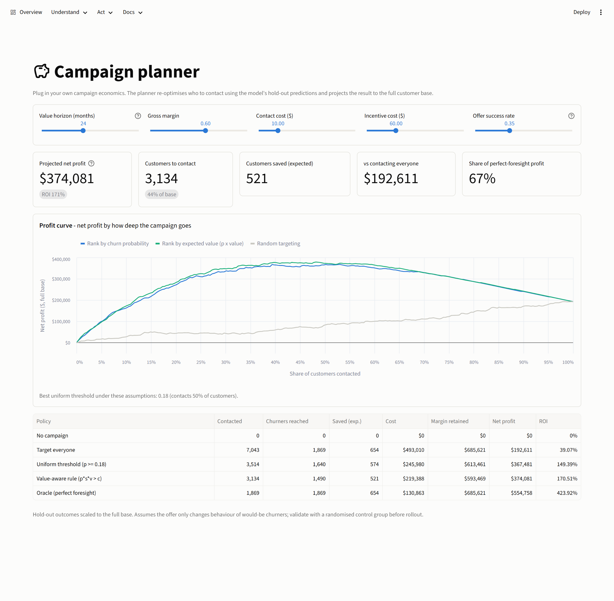
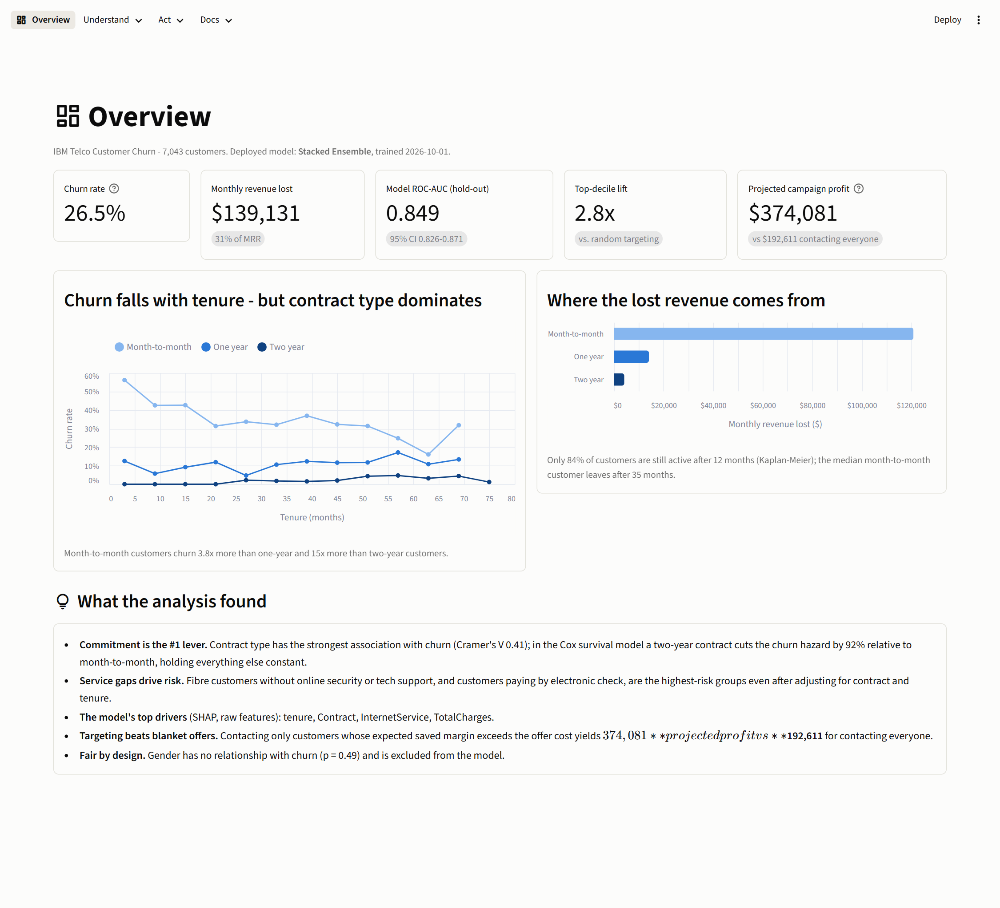
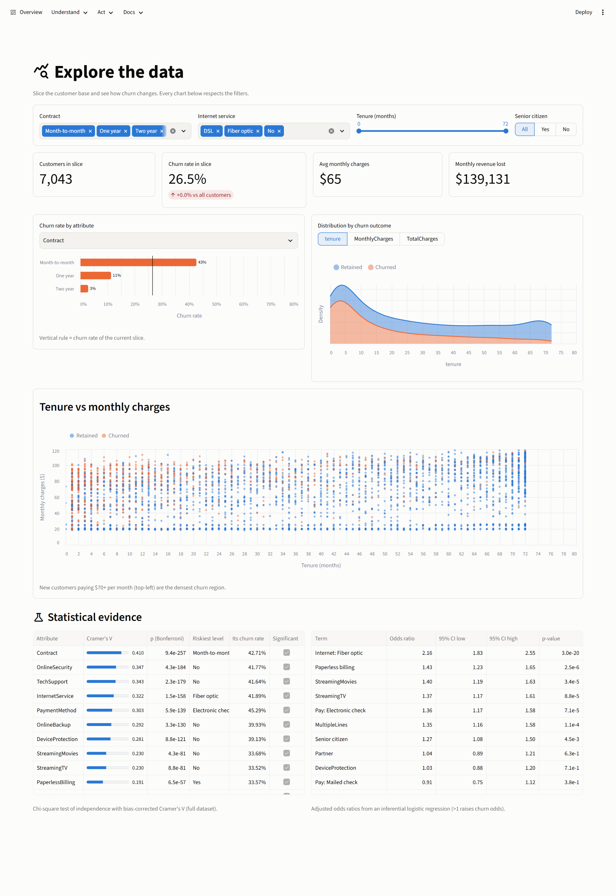
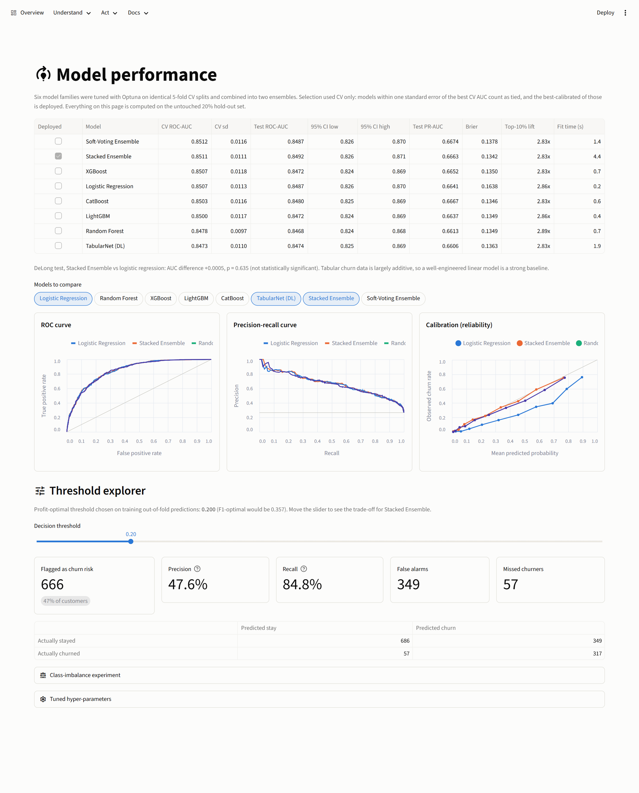
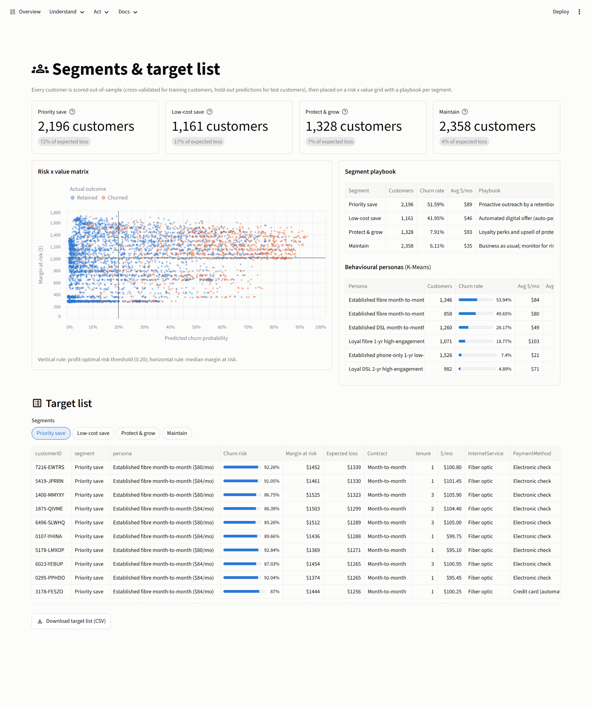

# Telco customer churn: from prediction to a profitable retention campaign

End-to-end churn analytics on the IBM Telco Customer Churn dataset (7,043 customers). The project goes well beyond
"fit a classifier": it tests hypotheses with effect sizes, models *when* customers leave with survival analysis,
tunes six model families (including a PyTorch deep-learning model) plus two ensembles, measures uncertainty and statistical
significance, turns probabilities into a dollar-optimal retention policy, explains every prediction, audits fairness,
and ships as a tested dashboard, REST API and Docker image.

       

## Results

<!-- RESULTS:START -->
| Headline | Value |
|---|---|
| Deployed model | **Stacked Ensemble** (selected on 5-fold CV; tied models resolved by calibration) |
| Hold-out ROC-AUC [95% CI] | **0.849** [0.826, 0.871] |
| Hold-out PR-AUC / Brier score | 0.666 / 0.134 (base churn rate 26.5%) |
| Top-decile lift / churners caught in top 30% | **2.8x** / 67% |
| Projected retention-campaign profit (full base) | **$374,081** (ROI 171%) vs $192,611 contacting everyone |
| Monthly revenue lost to churn | $139,131 (30.5% of MRR) |

**Key findings**

* **Contract is the #1 lever:** month-to-month customers churn at 42.7%
  (3.8x one-year, 15x two-year) and drive
  87% of lost revenue.
* **The first year is the danger zone:** only 84% of customers survive 12 months;
  the median month-to-month customer leaves after 35 months.
* **Top model drivers (SHAP):** tenure, Contract, InternetService, TotalCharges, OnlineSecurity - fibre without security/tech support and electronic-check
  payment stay significant risk factors after adjusting for contract and tenure.
* **Contacting only customers whose expected saved margin exceeds the offer cost earns $374,081 - 1.9x the profit of contacting everyone ($192,611) while contacting 56% fewer customers.**
* **Six tuned model families and two ensembles land within a narrow AUC band** - tabular churn signal is largely additive, so the
  gains come from features, calibration and the decision rule rather than model complexity.

| Model | CV ROC-AUC | Test ROC-AUC | Test PR-AUC | Test Brier |
|---|---|---|---|---|
| Soft-Voting Ensemble | 0.8512 +/- 0.0116 | 0.8487 | 0.6674 | 0.1378 |
| **Stacked Ensemble** | 0.8511 +/- 0.0111 | 0.8492 | 0.6663 | 0.1342 |
| XGBoost | 0.8507 +/- 0.0118 | 0.8472 | 0.6652 | 0.1350 |
| Logistic Regression | 0.8507 +/- 0.0113 | 0.8487 | 0.6641 | 0.1638 |
| CatBoost | 0.8503 +/- 0.0116 | 0.8480 | 0.6667 | 0.1346 |
| LightGBM | 0.8500 +/- 0.0117 | 0.8472 | 0.6637 | 0.1349 |
| Random Forest | 0.8478 +/- 0.0097 | 0.8468 | 0.6613 | 0.1349 |
| TabularNet (DL) | 0.8473 +/- 0.0110 | 0.8474 | 0.6606 | 0.1363 |
<!-- RESULTS:END -->

The complete, auto-generated analysis (every number computed, none typed) is in **[reports/REPORT.md](reports/REPORT.md)**;
a narrative walkthrough is in **[notebooks/telco_churn_analysis.ipynb](notebooks/telco_churn_analysis.ipynb)**.




## What's inside

| Area | What was done |
|---|---|
| **Data quality** | Schema validation; the 11 blank `TotalCharges` values traced to `tenure = 0` (not yet billed) and set to 0 instead of being imputed |
| **Statistical EDA** | Chi-square + bias-corrected Cramer's V, Mann-Whitney U + rank-biserial effect sizes, Bonferroni correction, mixed-type association matrix, mutual information, and an **inferential logistic regression** with adjusted odds ratios and 95% CIs |
| **Survival analysis** | Kaplan-Meier curves with log-rank tests, a **Cox proportional-hazards** model (hazard ratios, concordance, Schoenfeld-residual PH checks), model-implied lifetime for customer archetypes |
| **Feature engineering** | Stateless, leak-free domain features shared by training and serving: service and protection counts, price change vs historical average, price per service, commitment, auto-pay, a fibre-without-support risk flag, tenure buckets |
| **Modelling** | Logistic regression, random forest, XGBoost, LightGBM, CatBoost (native categoricals) and **TabularNet** - a PyTorch MLP with entity embeddings, wrapped as a scikit-learn estimator - each tuned with **Optuna** (TPE + median pruning) on identical CV folds; plus **stacking** (logistic meta-learner on out-of-fold log-odds) and soft voting |
| **Evaluation** | Selection on CV only, hold-out scored once; bootstrap 95% CIs, **DeLong tests** between models, a one-standard-error tie rule with calibration as the tie-breaker, calibration (Brier, reliability diagrams), gains and lift, and an experiment showing why SMOTE / class weights were *not* used |
| **Business economics** | Profit curve, a **value-aware targeting rule** (contact iff p x success x value > cost) vs blanket and threshold policies, and a sensitivity grid over offer cost and success rate |
| **Explainability** | Raw-feature SHAP on the deployed ensemble (contributions in percentage points of churn probability), TreeSHAP on engineered features, permutation importance, per-customer waterfalls |
| **Segmentation** | Out-of-sample risk x value matrix with a playbook per segment; K-Means behavioural personas |
| **Responsible AI** | Group parity audit (AUC, TPR, FPR, selection rate); `gender` excluded, backed by a test (p = 0.49) and an ablation |
| **Delivery** | 9-page **Streamlit** dashboard, **FastAPI** service with validated schemas, Docker image, GitHub Actions CI, pytest suite (data, maths, models, API and every dashboard page) |

## The dashboard

`streamlit run app/streamlit_app.py`

| Page | What it does |
|---|---|
| Overview | KPIs, headline drivers, revenue at risk |
| Explore the data | Filter the base and see churn by any attribute, distributions and statistical evidence |
| Model performance | Leaderboard with CIs, interactive ROC / PR / calibration, threshold explorer |
| Explainability | Global SHAP and permutation importance, per-attribute SHAP distributions |
| Customer risk scorer | Edit any customer and get probability, risk tier, decision, a SHAP waterfall and **simulated next-best actions** |
| Campaign planner | Drag offer cost, success rate and margin; the policy and profit curve re-optimise live |
| Segments & target list | Risk x value matrix, personas, downloadable target list |
| Batch scoring | Upload a CSV and download scores |
| Full report | The auto-generated report, in-app |

**Customer risk scorer** - probability, decision, SHAP explanation and simulated next-best actions for any customer:



**Campaign planner** - change the economics and the targeting policy re-optimises live:



<details>
<summary>More screens: overview, data explorer, model performance, segments</summary>






</details>

## Quickstart

```bash
python -m venv .venv && source .venv/bin/activate        # Windows: .venv\Scripts\activate
pip install torch --index-url https://download.pytorch.org/whl/cpu
pip install -r requirements.txt

python run_pipeline.py              # full run: data -> EDA -> survival -> tuning -> evaluation -> XAI -> report
python run_pipeline.py --fast       # smoke run (a few trials per model)
python run_pipeline.py --reuse      # skip tuning, reuse models/best_params.json

streamlit run app/streamlit_app.py  # dashboard on http://localhost:8501
uvicorn api.main:app --reload       # API docs on http://127.0.0.1:8000/docs
pytest -q                           # test suite
python notebooks/build_notebook.py  # rebuild + execute the walkthrough notebook

docker build -t telco-churn . && docker run -p 8501:8501 telco-churn
```

Example API call:

```bash
curl -X POST "http://127.0.0.1:8000/predict?explain=true&actions=true" -H "Content-Type: application/json" -d '{
  "SeniorCitizen": 0, "Partner": "No", "Dependents": "No", "tenure": 2, "PhoneService": "Yes",
  "MultipleLines": "No", "InternetService": "Fiber optic", "OnlineSecurity": "No", "OnlineBackup": "No",
  "DeviceProtection": "No", "TechSupport": "No", "StreamingTV": "Yes", "StreamingMovies": "Yes",
  "Contract": "Month-to-month", "PaperlessBilling": "Yes", "PaymentMethod": "Electronic check",
  "MonthlyCharges": 99.5, "TotalCharges": 190.0}'
```

## Project structure

```
├── run_pipeline.py          # one-command, reproducible end-to-end pipeline
├── config.yaml              # split, tuning budget, business assumptions, SHAP budget
├── src/churn/
│   ├── data.py              # download, cleaning, validation, split
│   ├── features.py          # leak-free FeatureEngineer + preprocessing
│   ├── eda.py               # hypothesis tests, effect sizes, odds ratios, EDA figures
│   ├── survival.py          # Kaplan-Meier, log-rank, Cox PH
│   ├── deep.py              # PyTorch entity-embedding network (sklearn API)
│   ├── models.py            # model zoo, Optuna search spaces, stacking / voting
│   ├── train.py             # tuning, OOF predictions, selection, hold-out evaluation
│   ├── evaluate.py          # metrics, bootstrap CIs, DeLong test, diagnostic plots
│   ├── business.py          # campaign economics, policies, sensitivity
│   ├── explain.py           # raw-feature SHAP, TreeSHAP, permutation importance
│   ├── segmentation.py      # risk x value matrix, K-Means personas
│   ├── fairness.py          # group parity audit, gender ablation
│   ├── predict.py           # ChurnPredictor: scoring, explanations, next-best actions
│   ├── plotting.py          # one colour-vision-deficiency-safe visual system
│   └── report.py            # renders reports/REPORT.md + this README's results
├── app/                     # Streamlit dashboard (st.navigation, 9 pages)
├── api/main.py              # FastAPI scoring service
├── tests/                   # pytest: data, features, maths, models, API, dashboard pages
├── notebooks/               # narrative walkthrough notebook
├── reports/                 # REPORT.md, metrics.json, figures/, tables/
├── models/                  # deployed model, metadata, tuned hyper-parameters
├── Dockerfile, .github/workflows/ci.yml
```

## Design decisions worth calling out

* **The test set is touched once.** Hyper-parameters, model choice, the ensemble meta-learner and the business
  threshold are all fitted on training data or its out-of-fold predictions.
* **Calibration over raw AUC.** Several models tie on ranking quality; the campaign rule multiplies probabilities by
  dollar values, so calibration (Brier score) decides between them.
* **No SMOTE.** Re-balancing left AUC unchanged and damaged calibration (shown in the report); imbalance is handled
  where it belongs - in a cost-based decision rule.
* **Explanations in the business's vocabulary.** SHAP is computed over the 18 raw attributes through a numeric facade,
  so a manager reads "Contract = Month-to-month: +10 pp", not one-hot column names.
* **Honest causal framing.** Next-best-action effects are model-implied associations to prioritise A/B tests; the
  natural next step is an uplift model trained on campaign data.
* **Engineering for the hardware.** On a 14-thread laptop, `n_jobs=-1` made LightGBM ~100x slower (OpenMP thread
  contention on 5k rows) and CatBoost's CTR statistics were ~18x slower than one-hot for no AUC gain; single-threaded
  models with parallel Optuna trials cut tuning from hours to minutes.

## Data

[IBM Telco Customer Churn](https://github.com/IBM/telco-customer-churn-on-icp4d) sample dataset - downloaded
automatically by the pipeline to `data/raw/`.
