# Telco Customer Churn - Analysis & Modelling Report

*Auto-generated by `run_pipeline.py` on 2026-10-01T03:57:42+00:00 - every number below is computed, not typed.*
*Data: IBM Telco Customer Churn (7,043 customers, file hash `16320c9c1ec72448`).*

---

## 1. Executive summary

| | |
|---|---|
| Customers / churn rate | 7,043 / **26.5%** |
| Monthly recurring revenue lost to churn | **$139,131** (30.5% of MRR) |
| Deployed model | **Stacked Ensemble** |
| Test ROC-AUC [95% CI] | **0.8492** [0.826, 0.871] |
| Test PR-AUC / Brier | 0.6663 / 0.1342 |
| Top-decile lift | **2.83x** the base churn rate |
| Projected campaign profit (value-aware targeting, full base) | **$374,081** (ROI 171%) |
| vs. blanket "contact everyone" campaign | $192,611 |

**Key findings**

1. **Contract type is the single strongest churn driver.** Month-to-month customers churn at
   42.7% - 3.8x the one-year rate and
   15x the two-year rate - and account for
   87% of lost revenue.
2. **The first year is the danger zone.** Only 84% of customers survive 12 months
   (Kaplan-Meier); the median month-to-month customer is gone after
   35 months.
3. **Fibre optic without protection services, electronic-check payment and paperless billing** all raise churn odds
   even after adjusting for contract and tenure; security/tech-support add-ons lower it.
4. **Model-driven targeting pays.** Contacting only customers whose expected saved margin exceeds the offer cost earns $374,081 - 1.9x the profit of contacting everyone ($192,611) while contacting 56% fewer customers.
5. **Gender carries no signal** (chi-square p = 0.49); it is excluded from the model, and the
   ablation confirms this costs nothing (CV AUC 0.8500 without vs
   0.8502 with).

---

## 2. Data & quality

* 7,043 rows x 21 columns; one row per customer, target `Churn` (Yes/No).
* `TotalCharges` is stored as text with **11 blank values** - all for customers with `tenure = 0` (not yet billed),
  so they are set to 0 rather than imputed.
* No duplicate customer IDs; 22 rows share identical attributes (distinct customers with the same plan).
* Stratified 80/20 split -> 5,634 train / 1,409 test; the test set is used **once**, for final
  reporting.

## 3. Exploratory & statistical analysis

Every relationship is backed by a test and an effect size (chi-square + bias-corrected Cramer's V for categoricals,
Mann-Whitney U + rank-biserial correlation for numerics, Bonferroni-corrected).

* Strongest categorical associations (Cramer's V): Contract (0.41), OnlineSecurity (0.35), TechSupport (0.34), InternetService (0.32), PaymentMethod (0.30).
* Not significant after Bonferroni correction: MultipleLines, PhoneService, gender.

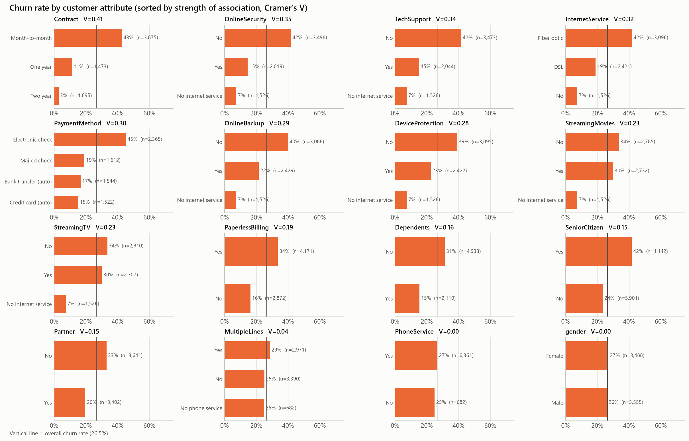

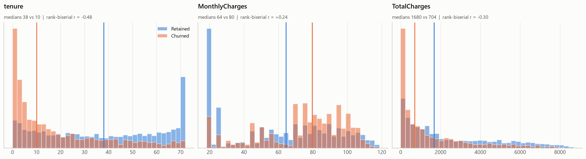
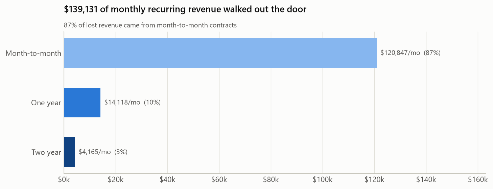
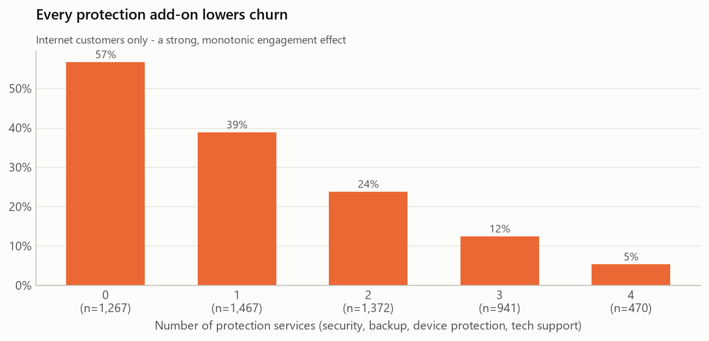
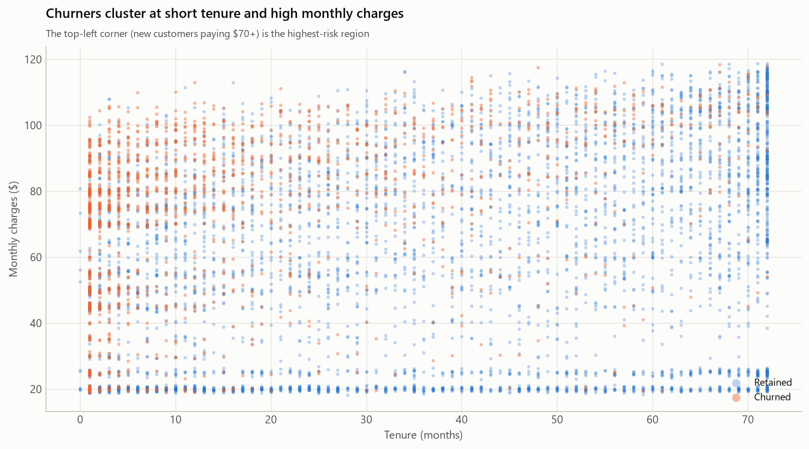
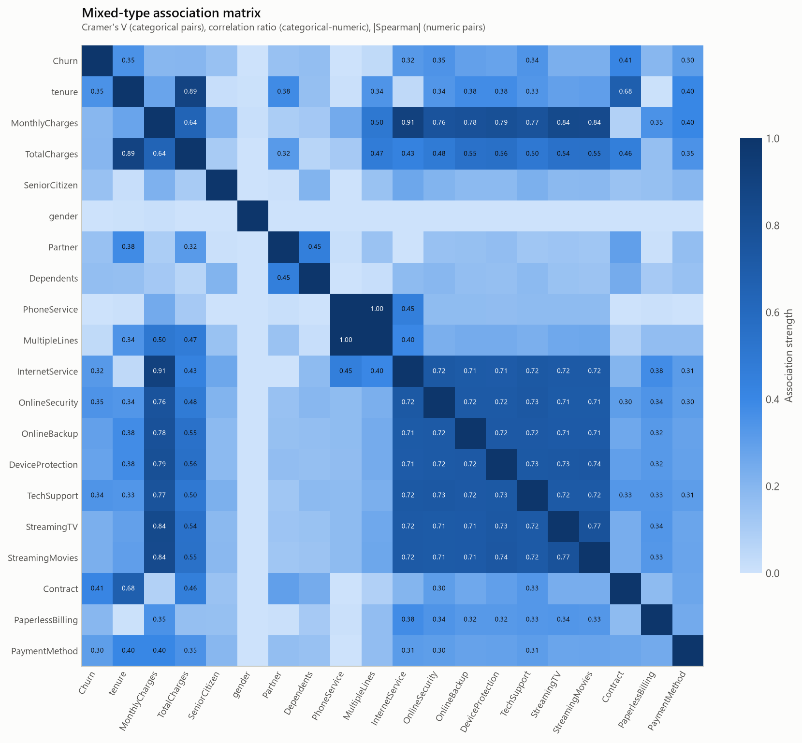
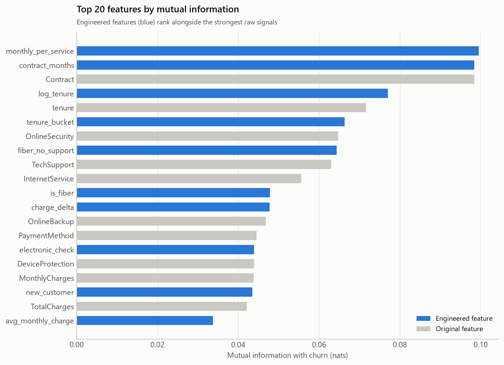

**Inferential logistic regression** (adjusted odds ratios with 95% CIs) separates each factor's effect from the
others - e.g. fibre optic remains a strong risk factor after controlling for price-related services and contract:

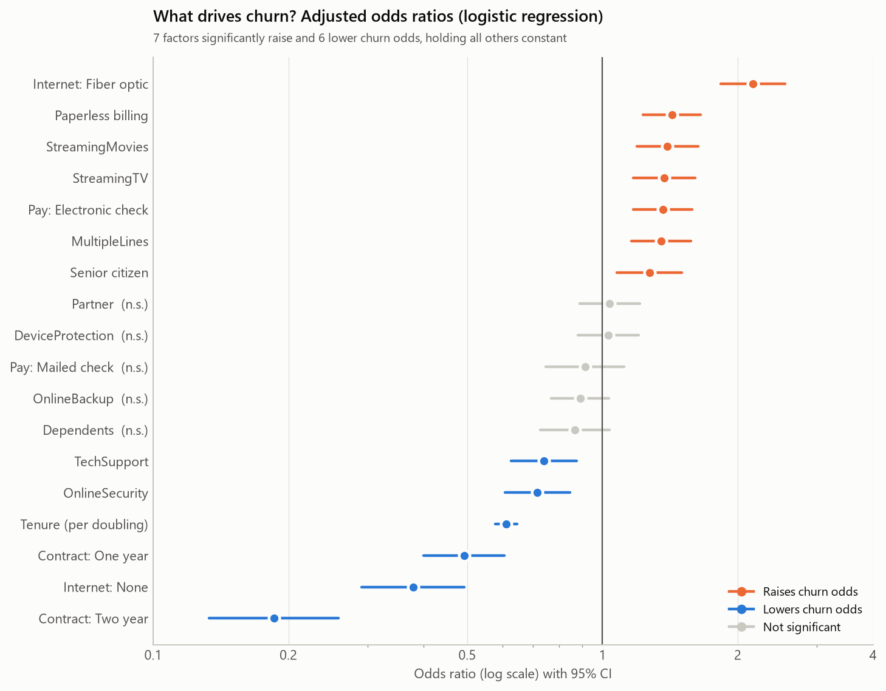

## 4. Survival analysis - *when* do customers leave?

* Log-rank tests: retention curves differ significantly by contract, internet service and payment method
  (all p < 1e-100).
* Cox proportional-hazards model: concordance **0.861**.
* Proportional-hazards assumption is violated (p < 0.01) for: Contract: One year, OnlineSecurity, Pay: Automatic, TechSupport, StreamingTV - their
  hazard ratios should be read as time-averaged effects (a stratified or time-varying Cox model is the next step).

| Archetype ($70/month) | 12-month retention | 24-month retention | Expected months (of first 72) |
|---|---|---|---|
| Month-to-month, e-check, fibre, no add-ons | 36% | 19% | 12 |
| One-year contract, auto-pay, security + support | 95% | 93% | 63 |
| Two-year contract, auto-pay, security + support | 99% | 98% | 69 |

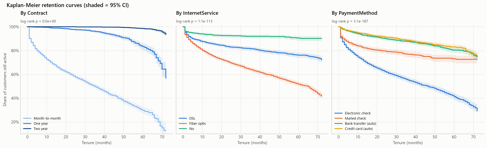
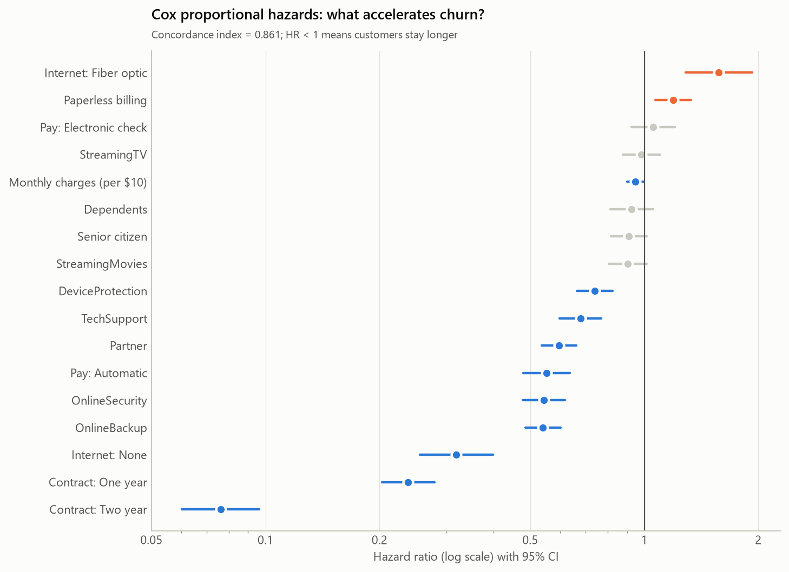
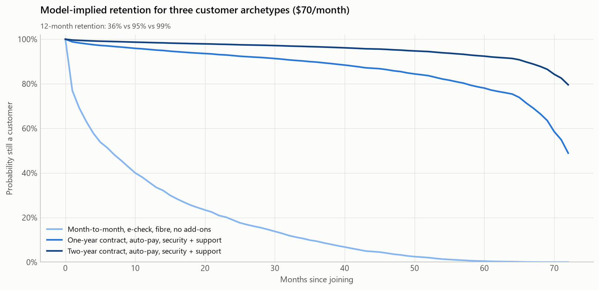

## 5. Modelling

**Feature engineering** (stateless, leak-free, shared by training and serving): service counts, protection/streaming
counts, average historical charge vs current charge, price per service, contract length, auto-pay and e-check flags,
family flag, fibre-without-support risk flag, tenure buckets, log-tenure.

**Protocol.** Six model families were tuned with Optuna (TPE sampler, median pruning) on identical 5-fold
stratified CV splits: logistic regression, random forest, XGBoost, LightGBM, CatBoost (native categoricals), and a
PyTorch **entity-embedding neural network** (TabularNet). Two ensembles were built from out-of-fold predictions: a
stacked logistic meta-learner (weights on log-odds: Logistic Regression +0.65, Random Forest +0.23, XGBoost +0.26, LightGBM +0.07, CatBoost -0.08, TabularNet (DL) -0.09) and a soft-voting average of the top three
(Logistic Regression, XGBoost, CatBoost). **Model selection used cross-validation only - never the test set.** Tuning budget: **310 Optuna trials** (Logistic Regression 40, Random Forest 40, XGBoost 80, LightGBM 80, CatBoost 40, TabularNet (DL) 30). The tuned gradient-boosting models converged on very shallow trees (max depth 2-3) - independent evidence that the churn signal is largely additive.

| Model | CV ROC-AUC (mean +/- sd) | Test ROC-AUC [95% CI] | Test PR-AUC | Test Brier |
|---|---|---|---|---|
| Soft-Voting Ensemble | 0.8512 +/- 0.0116 | 0.8487 [0.826, 0.870] | 0.6674 | 0.1378 |
| **Stacked Ensemble** | 0.8511 +/- 0.0111 | 0.8492 [0.826, 0.871] | 0.6663 | 0.1342 |
| XGBoost | 0.8507 +/- 0.0118 | 0.8472 [0.824, 0.869] | 0.6652 | 0.1350 |
| Logistic Regression | 0.8507 +/- 0.0113 | 0.8487 [0.826, 0.870] | 0.6641 | 0.1638 |
| CatBoost | 0.8503 +/- 0.0116 | 0.8480 [0.825, 0.869] | 0.6667 | 0.1346 |
| LightGBM | 0.8500 +/- 0.0117 | 0.8472 [0.824, 0.869] | 0.6637 | 0.1349 |
| Random Forest | 0.8478 +/- 0.0097 | 0.8468 [0.824, 0.868] | 0.6613 | 0.1349 |
| TabularNet (DL) | 0.8473 +/- 0.0110 | 0.8474 [0.825, 0.869] | 0.6606 | 0.1363 |

Test-AUC difference between the deployed model and plain logistic regression: +0.0005 (DeLong test p = 0.635, **not** statistically significant at 5%). On this dataset the signal is largely additive, so a well-engineered linear model is a very strong
baseline (test AUC 0.8487) - a finding worth stating plainly rather than hiding behind a leaderboard.

**Selection rule.** (1) Every model within one standard error (0.0052) of the best CV AUC
is treated as statistically tied on ranking quality - here: Soft-Voting Ensemble, Stacked Ensemble, XGBoost, Logistic Regression, CatBoost, LightGBM, Random Forest, TabularNet (DL). (2) Among tied models
the deployed one is the **best calibrated** (lowest out-of-fold Brier score), because the campaign rule multiplies
probabilities by dollar values: Stacked Ensemble OOF Brier 0.1329; XGBoost OOF Brier 0.1332; CatBoost OOF Brier 0.1333; LightGBM OOF Brier 0.1336; Random Forest OOF Brier 0.1343; TabularNet (DL) OOF Brier 0.1352; Soft-Voting Ensemble OOF Brier 0.1360; Logistic Regression OOF Brier 0.1615. The deployed Stacked Ensemble has the best calibration of the tied group.

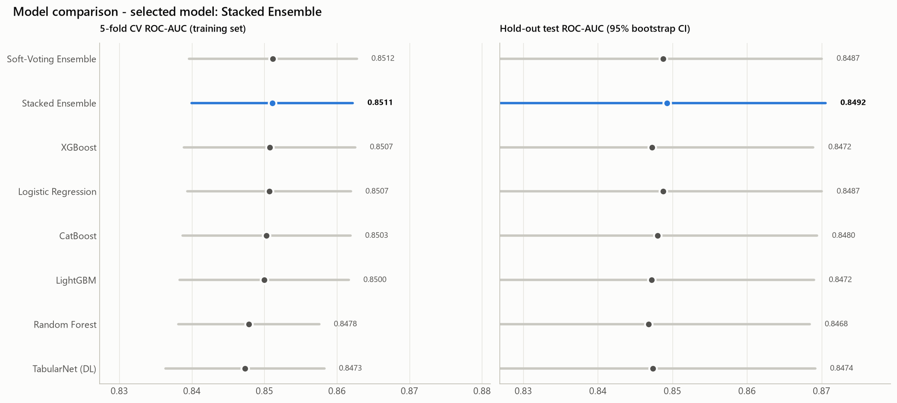
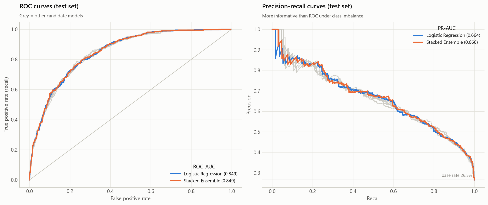
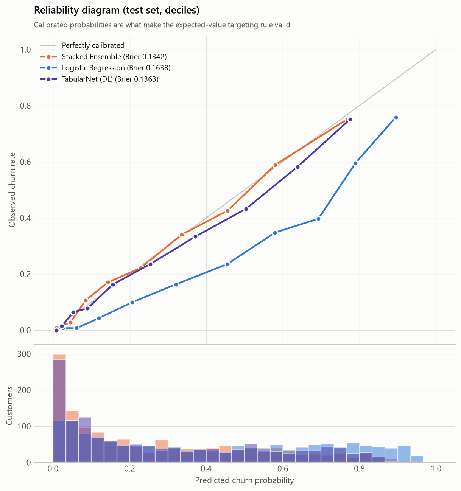
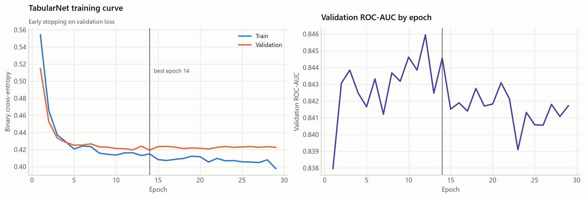

**Does re-balancing the classes help?** (tuned LightGBM, 5-fold OOF)

| Strategy | ROC-AUC | PR-AUC | Brier | Mean predicted p | Recall@0.5 | Precision@0.5 |
|---|---|---|---|---|---|---|
| None (natural 26.5% churn) | 0.8492 | 0.6651 | 0.1336 | 0.2651 | 0.5224 | 0.6641 |
| Class weighting (scale_pos_weight) | 0.8489 | 0.6634 | 0.1616 | 0.4101 | 0.8114 | 0.5160 |
| SMOTE oversampling | 0.8452 | 0.6558 | 0.1394 | 0.3168 | 0.6488 | 0.5951 |
| Random undersampling | 0.8489 | 0.6597 | 0.1632 | 0.4152 | 0.8120 | 0.5131 |

Re-balancing leaves ranking quality (ROC-AUC) essentially unchanged but distorts probabilities (higher Brier, inflated
mean prediction). Because decisions are made with a cost-based threshold on calibrated probabilities, the natural
class distribution is kept.

### Hold-out performance of the deployed model (threshold = 0.200)

| ROC-AUC | PR-AUC | Brier | Precision | Recall | F1 | Specificity | MCC | Top-decile lift |
|---|---|---|---|---|---|---|---|---|
| 0.8492 | 0.6663 | 0.1342 | 0.476 | 0.848 | 0.610 | 0.663 | 0.451 | 2.83x |

Top-3 deciles capture 67% of all churners.

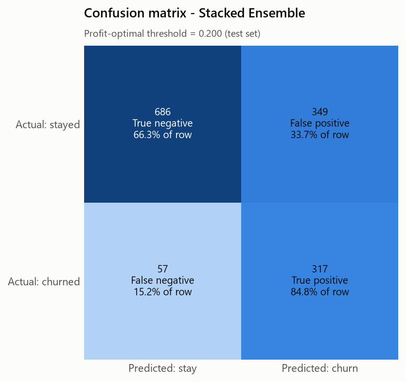
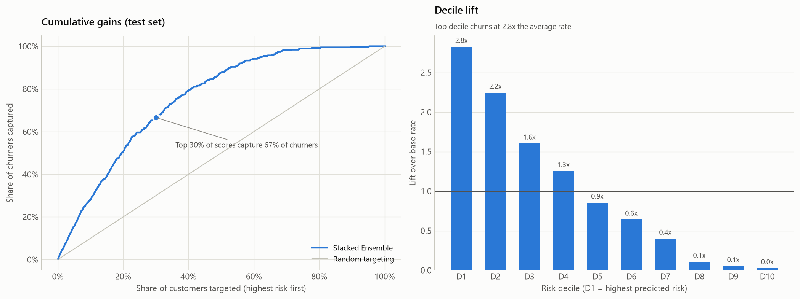
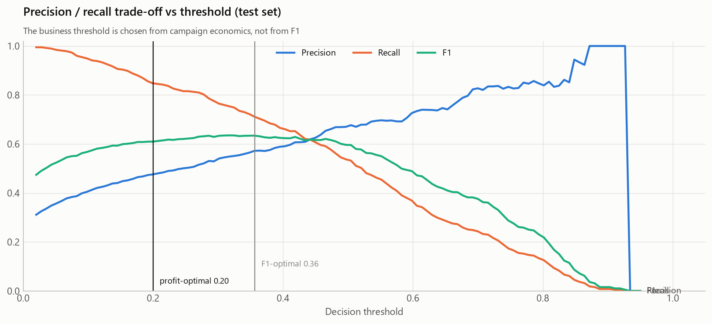

## 6. Business impact - retention campaign economics

Assumptions (all in `config.yaml`): margin at risk = MonthlyCharges x 24 months x
60% gross margin; contact cost $10 + incentive
$60 per targeted customer; 35% of targeted churners are saved.
The uniform threshold was optimised on **training OOF** predictions and then applied to the test set. Figures are
test-set outcomes scaled x5.00 to the full customer base.

| Policy | Customers contacted | Churners reached | Campaign cost | Margin retained | Net profit | ROI |
|---|---|---|---|---|---|---|
| No campaign | 0 | 0 | $0 | $0 | $0 | - |
| Target everyone | 7,043 | 1,869 | $493,010 | $685,621 | $192,611 | 39% |
| Uniform threshold (p >= 0.20) | 3,329 | 1,585 | $233,034 | $593,790 | $360,757 | 155% |
| Value-aware rule (p*s*v > c) | 3,134 | 1,490 | $219,388 | $593,469 | $374,081 | 171% |
| Oracle (perfect foresight) | 1,869 | 1,869 | $130,863 | $685,621 | $554,758 | 424% |

The **value-aware rule** (target iff p x success x value > cost) needs no tuning because the model's probabilities
are calibrated; it captures 67% of the perfect-foresight profit.

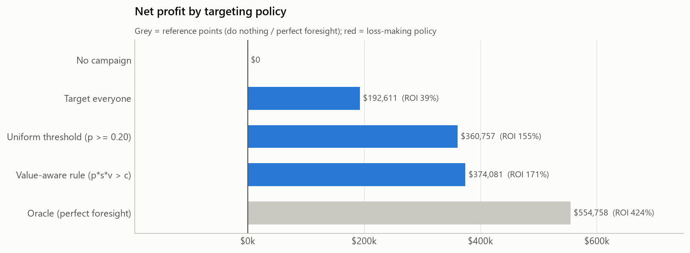
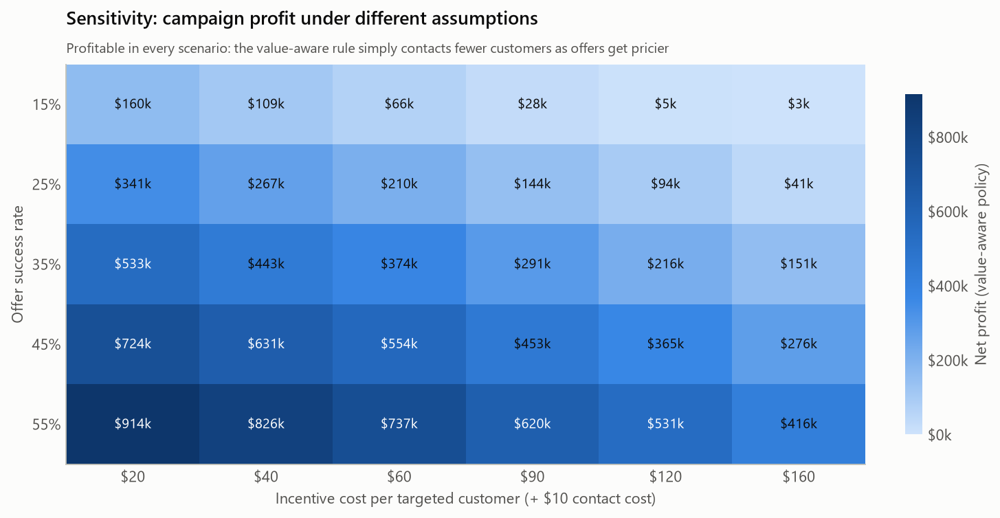

## 7. Explainability

* Raw-feature SHAP on the deployed model - top drivers: **tenure, Contract, InternetService, TotalCharges, OnlineSecurity**.
* Permutation importance on the hold-out set and TreeSHAP on engineered features agree on the ranking.

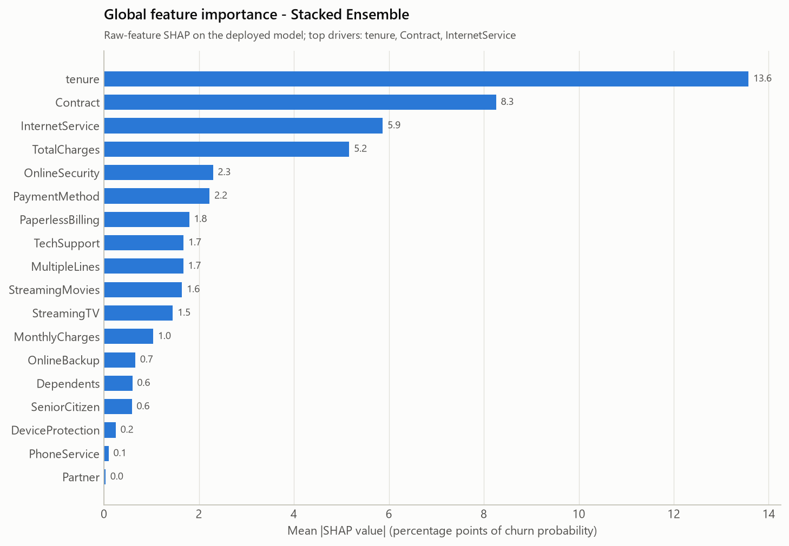
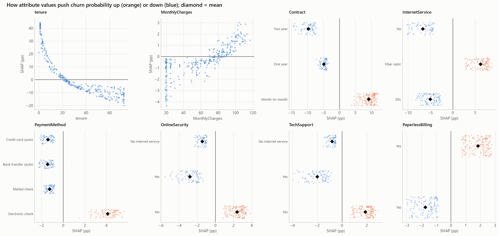
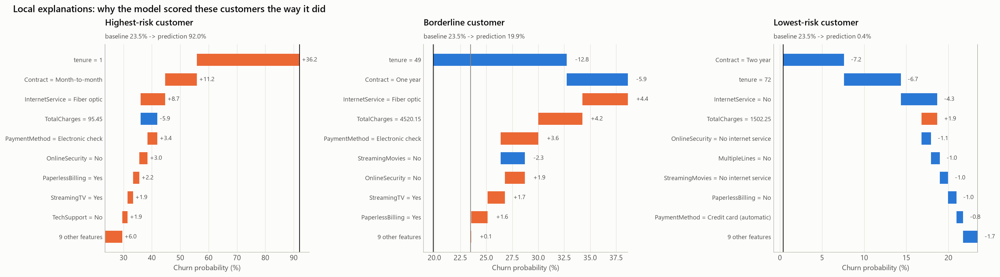
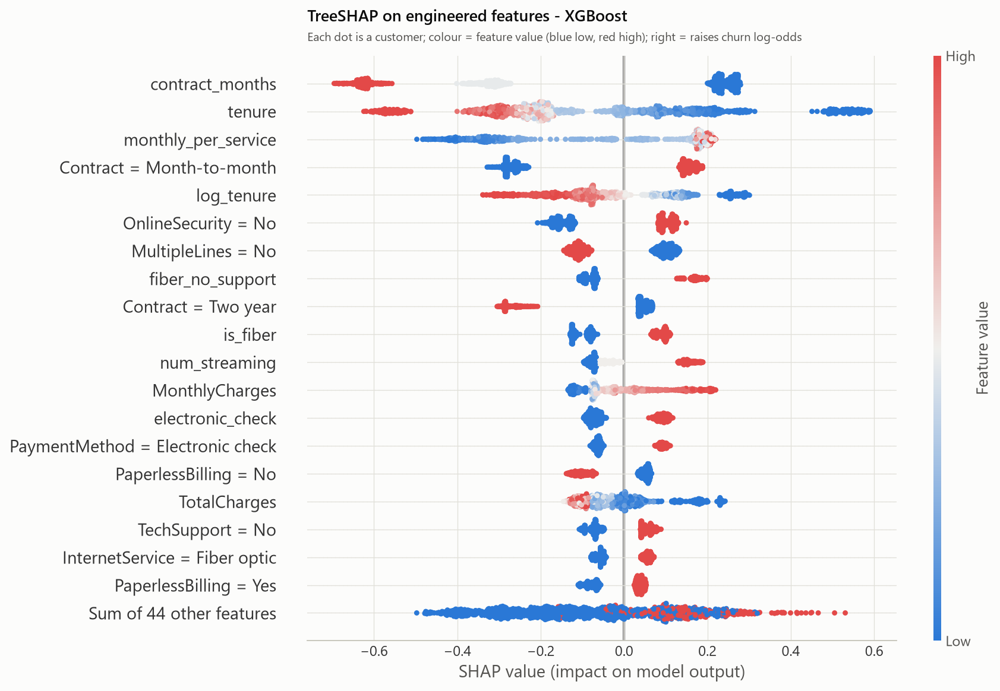
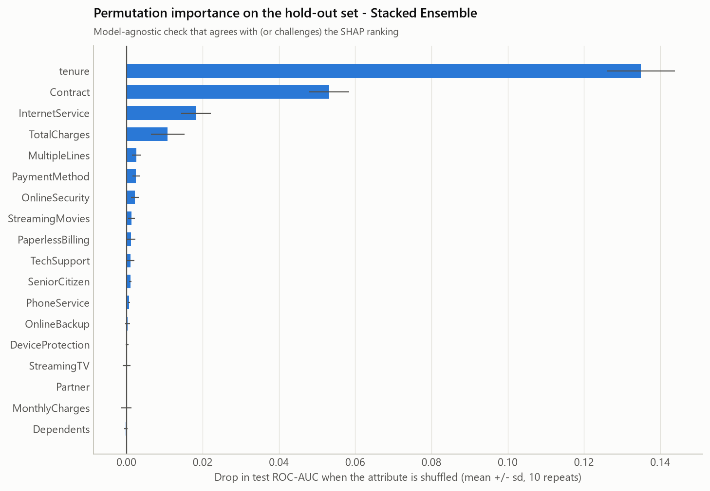

## 8. Segmentation - who to call first

Every customer is scored **out-of-sample** (OOF for training rows, hold-out predictions for test rows) and placed on
a risk x value grid:

| Segment | Customers | Actual churn | Avg monthly $ | Share of expected loss |
|---|---|---|---|---|
| Priority save | 2,196 | 51.6% | $89 | 72.2% |
| Low-cost save | 1,161 | 41.9% | $46 | 16.6% |
| Protect & grow | 1,328 | 7.9% | $93 | 7.2% |
| Maintain | 2,358 | 6.1% | $35 | 4.0% |

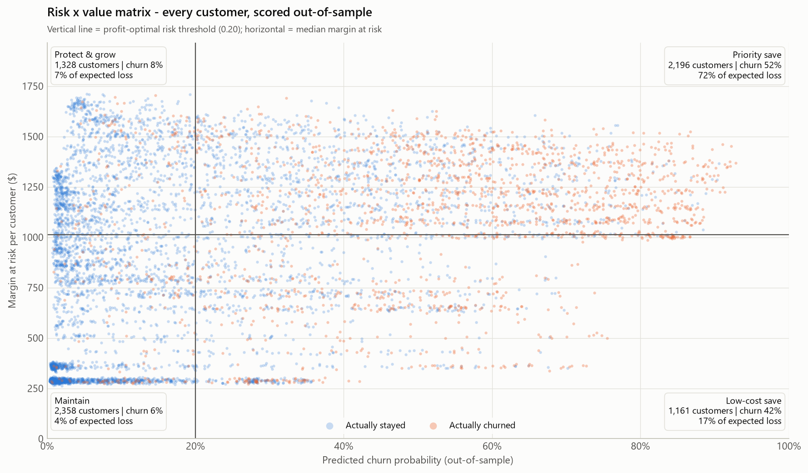
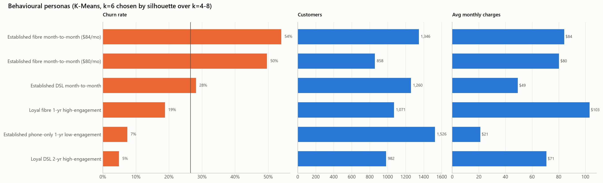

## 9. Responsible AI - fairness audit

Group metrics on the test set with the value-aware targeting policy:

| Attribute | AUC gap | TPR gap | FPR gap | Selection-rate ratio | Base-rate ratio |
|---|---|---|---|---|---|
| Dependents | 0.020 | 0.149 | 0.215 | 0.49 | 0.53 |
| Partner | 0.030 | 0.053 | 0.143 | 0.65 | 0.56 |
| SeniorCitizen | 0.068 | 0.192 | 0.326 | 0.52 | 0.53 |
| gender | 0.005 | 0.008 | 0.012 | 0.99 | 0.89 |

* **Gender:** AUC gap 0.005, selection-rate ratio 0.99 - no material disparity (and gender is not a model input).
* **Largest gap - SeniorCitizen:** the model ranks SeniorCitizen = Yes customers less accurately (AUC 0.784 vs 0.852, n = 222 in the test set).
* **Selection rates** differ mainly because base churn rates differ (SeniorCitizen = Yes: base rate 44%, targeted 75%). Here being targeted means *receiving* a retention offer, so higher selection is not an adverse outcome; the actionable gap is accuracy. Mitigations: monitor group-wise AUC/calibration in production, and consider group-aware calibration or more data for the smaller group.

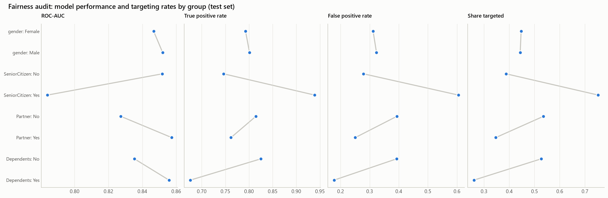

## 10. Limitations & next steps

* **Snapshot data** - one observation per customer, no event dates or usage history; features such as support-call
  volume or network quality would likely add signal.
* **Associational, not causal** - SHAP and the dashboard's what-if simulator show what the model *associates* with
  lower risk. Offer effectiveness must be measured with a randomised test; the natural next step is an **uplift
  model** (T-/X-learner) trained on campaign data to target *persuadable* customers rather than merely high-risk ones.
* Campaign economics are illustrative assumptions; the sensitivity grid shows where the business case holds.
* Proportional-hazards violations suggest a stratified / time-varying Cox model for lifetime forecasting.
* In production: monitor score drift (PSI), calibration and realised campaign lift; retrain quarterly.

## 11. Reproducibility

* One command: `python run_pipeline.py` (full) or `--fast` (smoke) or `--reuse` (skip tuning).
* Seeds fixed everywhere; tuned hyper-parameters saved to `models/best_params.json`.
* Versions: python 3.13.15, scikit-learn 1.9.1, xgboost 3.4.1, lightgbm 4.7.0, catboost 1.2.10, torch 2.14.1+cpu, shap 0.52.0, optuna 5.0.0, pandas 3.0.6, numpy 2.5.3.
* Pipeline runtime: 8.1 min. Single-customer inference latency: 108.3 ms.
